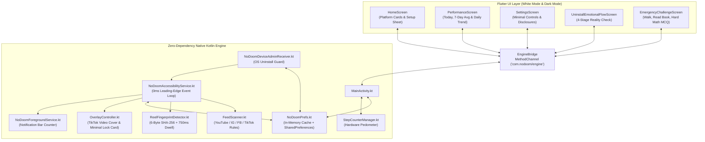

<div align="center">

<picture>
  <source media="(prefers-color-scheme: dark)" srcset="assets/images/logo_dark.png">
  <source media="(prefers-color-scheme: light)" srcset="assets/images/logo_light.png">
  
</picture>

# No-Reels

**Surgical Short-Form Video Blocker & Anti-Doomscrolling Engine for Android**

*Block YouTube Shorts, Instagram Reels, Facebook Reels, and TikTok Videos — without blocking the rest of the app.*

[-10B981?style=flat-square)](#100-offline--zero-serverbackend-architecture)
[-09090B?style=flat-square)](#building-from-source)
[](#system-architecture)
[](LICENSE)

</div>

---

> [!IMPORTANT]
> ### 100% Offline — Zero Server, Zero Backend, Zero Internet Permission
> **No-Reels is completely offline by design.**
> - **No Internet Permission:** `<uses-permission android:name="android.permission.INTERNET" />` is **not** declared in [`AndroidManifest.xml`](android/app/src/main/AndroidManifest.xml). The Android OS kernel physically blocks the app from opening any network socket.
> - **No Server or Backend:** There are no backend APIs, no cloud databases, no user accounts, no telemetry pings, no third-party analytics SDKs, and no crash reporters.
> - **Zero External Database:** All daily counters, 7-day history logs, and per-app rules are persisted locally in flat Android `SharedPreferences` backed by an in-memory static cache (`NoDoomPrefs.kt`) for zero disk-I/O latency.

---

## Table of Contents

1. [Overview & Philosophy](#overview--philosophy)
2. [Surgical Platform Capabilities](#surgical-platform-capabilities)
3. [Core Features](#core-features)
4. [100% Offline & Zero Server/Backend Architecture](#100-offline--zero-serverbackend-architecture)
5. [System Architecture](#system-architecture)
6. [Codebase Structure](#codebase-structure)
7. [Building from Source](#building-from-source)
8. [Google Play Store Compliance](#google-play-store-compliance)
9. [Contributing](#contributing)
10. [License (Non-Commercial Open Source)](#license-non-commercial-open-source)

---

## Overview & Philosophy

Most app blockers force an all-or-nothing choice: block the entire Instagram, YouTube, Facebook, or TikTok app, or leave yourself exposed to infinite short-form video feeds. Yet users still need **YouTube** for long-form tutorials and lectures, **Instagram** for Direct Messages and friends' posts, **Facebook** for groups and Marketplace, and **TikTok** for inbox messages.

**No-Reels** solves this surgically:
- It inspects on-screen view hierarchy IDs in real time (`0ms` leading-edge execution) inside an isolated, offline Android `AccessibilityService`.
- When you enter a short-form feed (**Shorts** or **Reels**), it immediately navigates you back out (or places a precision bounded cover over the **TikTok** video player) while leaving DMs, search, subscriptions, comments, and long-form content completely untouched.

---

## Surgical Platform Capabilities

| Platform | Target Packages | Short-Form Feed Blocked | What Remains Usable | Detection & Blocking Strategy |
| :--- | :--- | :--- | :--- | :--- |
| **YouTube** | `com.google.android.youtube`, Kids, ReVanced, RVX, Morphe, Vanced | **YouTube Shorts** | Long-form videos, Search, Subscriptions, Comments, Library | Detects `reel_player_page_container`, `reel_recycler`, `shorts_container`, and selected `Shorts` tab (ignoring home-feed `shorts_shelf`) → fires `GLOBAL_ACTION_BACK` |
| **Instagram** | `com.instagram.android`, `com.instagram.lite` | **Instagram Reels** | Direct Messages (DMs), Stories, Photo Posts, Profile, Search | Detects `clips_viewer_view_pager` + IG Lite structural top `RecyclerView` → fires `GLOBAL_ACTION_BACK`. Includes optional **Allow DM Videos** exemption (`sender_username_or_fullname` + `reply_bar_edittext`) |
| **Facebook** | `com.facebook.katana`, `com.facebook.lite` | **Facebook Reels** | Main Feed, Messenger, Groups, Marketplace, Notifications | 3-layer detector: selected `Reels` tab + center-screen `Reels tab details` + pruned structural signature (`RecyclerView ≥ 90%×75%` → long-clickable `Button` → `SurfaceView`) → fires `GLOBAL_ACTION_BACK` |
| **TikTok** | `com.zhiliaoapp.musically`, `trill`, `aweme`, `musically.go` | **TikTok Video Player** | Inbox / DMs, Profile, Search, Bottom Navigation Bar | Locates exact screen bounds of `player_view` / `simplayer_api_player_view` / `view_rootview` → renders a bounded opaque overlay strictly over the video player region |

---

## Core Features

### 1. Accurate Video Counting & Time-Wasted Tracking
- **6-Byte SHA-256 Video Fingerprinting ([`ReelFingerprintDetector.kt`](android/app/src/main/kotlin/com/nodoom/nodoom/ReelFingerprintDetector.kt)):** Hashes visible `@creator|caption` metadata against a 40-video ring buffer so scrolling back and forth or opening comments never double-counts a video.
- **Decoupled `750ms` Dwell Timer:** A video is only counted after remaining on screen for at least `750ms`. The dwell timer runs on an isolated `Handler` callback (`dwellRunnable`) so it never delays `0ms` feed-blocking scans.
- **Comment-Sheet Pause Detection:** Automatically pauses counter increments while comment or share bottom sheets are open.

### 2. Daily Performance Screen & 7-Day Analytics
- **Dedicated Performance Dashboard ([`performance_screen.dart`](lib/screens/performance_screen.dart)):**
  - **Today's Performance:** Live Reels count, active time wasted today, and real-time comparison badge (`On Track vs 7d Avg` / `Above 7d Avg`).
  - **7-Day Averages & Totals:** Calculates 7-day average reels/day, 7-day average time/day, and cumulative 7-day totals.
  - **7-Day Trend Bar Chart & Daily History Log:** Visual daily bar chart alongside a day-by-day log of the past 7 calendar days.
  - **Per-Platform Progress Bars:** Minimal daily usage progress bar on every platform's settings sheet showing exact time used vs daily allowance (`4m 10s / 15m finished`).

### 3. Live Notification Bar Counter
- **Zero Screen Obstruction ([`NoDoomForegroundService.kt`](android/app/src/main/kotlin/com/nodoom/nodoom/NoDoomForegroundService.kt)):** Displays a live dynamic bitmap counter badge (`14R`) in the Android status bar and a silent ongoing summary (`No-Reels · 14 Reels · 08m 20s`) in the notification drawer.
- **3 Modes:** `Permanent` (always visible), `In-Feed Only` (visible only while inside monitored social apps), or `Off`.

### 4. Multi-Layer Uninstall Protection & Emotional Reality-Check Flow
- **Device Admin + Accessibility Self-Defense ([`NoDoomDeviceAdminReceiver.kt`](android/app/src/main/kotlin/com/nodoom/nodoom/NoDoomDeviceAdminReceiver.kt) & [`NoDoomAccessibilityService.kt`](android/app/src/main/kotlin/com/nodoom/nodoom/NoDoomAccessibilityService.kt)):** When **Strict Uninstall Lock** is enabled, unauthorized attempts to uninstall the app, force-stop it in App Info, or deactivate Device Admin immediately bounce out and display a minimal floating lock card.
- **4-Stage Emotional Uninstall Journey ([`uninstall_emotional_flow_screen.dart`](lib/screens/uninstall_emotional_flow_screen.dart)):** Turning off Strict Uninstall Lock walks the user through 4 reflective stages:
  1. **Life & Time Saved Overview:** Calculates total hours of life saved and estimated reels dodged compared to the 95-minute/day short-form average.
  2. **"What is your reason to uninstall?":** Honest self-reflection prompt (*"I want to destroy my time"*, *"I hate my life & focus"*, *"My life, My rules"*, etc.).
  3. **"Why are Reels more important than your life?":** Second reality-check prompt (*"Strangers dancing > My real life"*, *"I prefer a 10-second memory span"*, etc.).
  4. **Final Reality Check:** Echoes their chosen confessions above the **`Let me destroy my valuable times`** button, leading to the final unlock challenge. Once unlocked, Device Admin and Strict Lock are automatically deactivated so the app can be uninstalled cleanly.

### 5. Three Offline Emergency Unlock Challenges (5-Minute Bypass Pass)
- **Make a Walk:** Hardware pedometer (`TYPE_STEP_DETECTOR` / `TYPE_STEP_COUNTER` with accelerometer fallback) requiring `100`, `200`, `500`, or `1000` physical steps.
- **Read Book:** Curated offline philosophical chapters (*Marcus Aurelius*, *Seneca*, *Epictetus*, *Sun Tzu*) with an enforced `15s/page` reading timer and a `3/3` comprehension quiz.
- **Hard Math (MCQ):** 5 consecutive multi-step compound equations (`((A × B) + (C × D)) − E`, `(A² + B²) − (C × D)`, `Ax + (B × C) = D`, `(A³ − (B × C)) + D`) answered via a 4-option multiple-choice grid with same-last-digit distractors.

---

## 100% Offline & Zero Server/Backend Architecture

You can independently verify that **No-Reels** has zero network capability using the Android SDK `aapt` tool on any built APK:

```bash
aapt dump permissions build/app/outputs/flutter-apk/app-release.apk
```

Expected output contains **no** `android.permission.INTERNET` and **no** network state permissions:

```text
package: com.nodoom.nodoom
uses-permission: name='android.permission.FOREGROUND_SERVICE'
uses-permission: name='android.permission.FOREGROUND_SERVICE_SPECIAL_USE'
uses-permission: name='android.permission.POST_NOTIFICATIONS'
uses-permission: name='android.permission.REQUEST_IGNORE_BATTERY_OPTIMIZATIONS'
uses-permission: name='android.permission.ACTIVITY_RECOGNITION'
uses-permission: name='android.permission.RECEIVE_BOOT_COMPLETED'
```

---

## System Architecture



---

## Codebase Structure

```text
No-Reels/
├── android/app/src/main/
│   ├── AndroidManifest.xml                  # Offline manifest (zero INTERNET permission)
│   ├── kotlin/com/nodoom/nodoom/
│   │   ├── MainActivity.kt                  # Flutter MethodChannel bridge & permission launcher
│   │   ├── NoDoomPrefs.kt                   # In-memory static state + SharedPreferences + 7d history
│   │   ├── NoDoomAccessibilityService.kt    # Real-time 0ms feed interceptor & self-defense guard
│   │   ├── FeedScanner.kt                   # Surgical view-ID & layout detectors for YT/IG/FB/TikTok
│   │   ├── ReelFingerprintDetector.kt       # 6-byte SHA-256 video deduplication & 750ms dwell check
│   │   ├── OverlayController.kt             # TikTok bounded player cover & minimal floating lock card
│   │   ├── NoDoomForegroundService.kt       # Live Notification Bar counter & bitmap badge generator
│   │   ├── NoDoomDeviceAdminReceiver.kt     # Device Administrator receiver for uninstall protection
│   │   └── StepCounterManager.kt            # Hardware step detector + accelerometer fallback
│   └── res/
│       ├── xml/accessibility_service_config.xml
│       ├── xml/device_admin_policies.xml
│       └── values/strings.xml
├── assets/
│   ├── challenges/ebooks.json               # Offline philosophical passages & 3/3 quizzes
│   ├── fonts/                               # Bundled offline PlusJakartaSans & JetBrainsMono fonts
│   └── images/                              # Adaptive light/dark circular No-Reels logos
├── lib/
│   ├── main.dart                            # Application entry point & theme listener
│   ├── engine_bridge.dart                   # Typed Dart models & MethodChannel wrapper
│   ├── challenges/challenge_logic.dart      # Compound MCQ Hard Math generator & E-Book parser
│   ├── theme/app_theme.dart                 # White Mode & Dark Mode palettes + haptic engine
│   ├── widgets/connected_pill_item.dart     # Vector brand logos, connected pills & Play disclosures
│   └── screens/
│       ├── home_screen.dart                 # Main dashboard, platform cards & setup bottom sheet
│       ├── performance_screen.dart          # Daily performance, 7-day average & trend bar chart
│       ├── settings_screen.dart             # Minimal settings & in-app privacy policy sheet
│       ├── emergency_challenge_screen.dart  # Bento challenge chooser & Walk/Book/MCQ Math views
│       └── uninstall_emotional_flow_screen.dart # 4-stage emotional reality-check before unlock
├── test/
│   └── widget_test.dart                     # Unit & widget test suite
├── LICENSE                                  # PolyForm Noncommercial License 1.0.0
├── PRIVACY_POLICY.md                        # Zero-data-collection privacy policy
├── CONTRIBUTING.md                          # Open-source contribution guidelines
├── CODE_OF_CONDUCT.md                       # Contributor Covenant Code of Conduct
└── SECURITY.md                              # Security & offline threat-model policy
```

---

## Building from Source

### Prerequisites
- **Flutter SDK:** `^3.11.1` (Dart 3)
- **JDK:** Java 17
- **Android SDK:** Compile SDK 35 / Min SDK 24 (Android 7.0+)

### 1. Clone & Verify
```bash
git clone https://github.com/rabbi-hasan-229/No-Doomscrolling.git No-Reels
cd No-Reels

# Run static analyzer & unit/widget test suite
flutter analyze
flutter test
```

### 2. Build Debug APK
```bash
flutter build apk --debug
# Output: build/app/outputs/flutter-apk/app-debug.apk
```

### 3. Build Signed Release APK / Play Store App Bundle (AAB)
1. Copy [`android/key.properties.example`](android/key.properties.example) to `android/key.properties` (ignored by Git) and fill in your keystore credentials. *(If `android/key.properties` is omitted, Gradle automatically falls back to debug signing so open-source contributors can test release builds out of the box.)*
2. Run:
   ```bash
   flutter build apk --release
   flutter build appbundle --release
   ```

---

## Google Play Store Compliance

No-Reels is built to satisfy Google Play Store review requirements without altering its core blocking logic:
- **`android:isAccessibilityTool="false"`:** Explicitly declared in [`accessibility_service_config.xml`](android/app/src/main/res/xml/accessibility_service_config.xml).
- **Prominent In-App Disclosures:** [`PlayStoreDisclosures`](lib/widgets/connected_pill_item.dart) presents mandatory user-consent dialogs explaining local RAM view-tree inspection before opening Android Accessibility or Device Admin settings.
- **Opt-In Strict Lock:** `strictUninstallLock` defaults to `false` on fresh install so automated Play Store review bots can install and uninstall the app freely, and arms automatically when the user opts in to Device Admin Lock.
- **In-App & Hosted Privacy Policy:** Accessible inside **Settings → Privacy Policy** and in [`PRIVACY_POLICY.md`](PRIVACY_POLICY.md).

---

## Contributing

Contributions, bug reports, and updated view-ID selectors for new social app versions are welcome under our non-commercial open-source terms! Please read [CONTRIBUTING.md](CONTRIBUTING.md) and [CODE_OF_CONDUCT.md](CODE_OF_CONDUCT.md) before opening a Pull Request.

---

## License (Non-Commercial Open Source)

Copyright © 2026 **No-Reels** Authors & Contributors.

This project is source-available / open-source under the **[PolyForm Noncommercial License 1.0.0](LICENSE)**.
- **Permitted:** Personal use, academic study, security auditing, non-commercial modifications, and free non-commercial sharing with attribution.
- **Strictly Prohibited:** Any commercial use, paid distribution, monetization (ads, subscriptions, in-app purchases), corporate use, or publishing commercial/monetized derivatives on any app store. See [LICENSE](LICENSE) for full legal terms.
